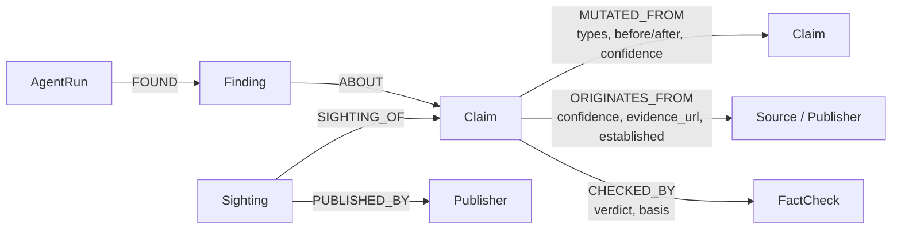

# Lineage

> Everyone gets their news from reels. A claim is never new; it's a mutation of something older. Lineage shows you the family tree.

Paste a claim. Four agents split it into atomic claims, find where each one came from, how it mutated, who pushed it and which fact-checks exist. The answer is an **evidence trail with calibrated confidence**, drawn as a lineage graph. When the graph knows nothing, the answer is **"Unknown"**. Lineage never gives a bare true/false.

Built for **Graph Hacks 2026 (WeMakeDevs × FalkorDB)**, solo entry.

| | |
|---|---|
| **Tracks** | **Track 1: Agents That Act on Connected Data** · **Track 2: Agent Memory and Coordination** |
| **Live demo** | _URL added at deploy_ (recorded mode, see [Modes](#two-modes-local-and-recorded)) |
| **Demo video** | _link added at submission_ |
| **Stack** | FalkorDB 4.22 · Next.js 16 · TypeScript · Gemini (agents) · gemini-embedding-001 (vectors) |

## The idea in one example

A 2012 chain email claimed NASA had confirmed three days of darkness. In 2014 a satire site made it six days. It came back as 15 days in 2015, with a Bible framing in 2016, and with a "1,000-page report sent to the White House" in 2017. Fact-checkers debunked the versions as **fabricated**. Paste a 2026 version and Lineage:

1. finds the 2017 version with a vector search in FalkorDB,
2. records the new claim as a mutation of it (`date_shift: "November 2017" → "November 2026"`),
3. walks up the chain and carries the 2017 debunk down to the new claim, **because the reason it was false (fabricated) still applies after a date change**, with confidence decaying per hop (0.85),
4. shows that the origin is **contested** (Huzlers.com vs a 2012 chain email), because two fact-checkers disagree.

Paste a version that **credits the true author** of a misattributed quote (the "Bill Gates' 11 rules" list was written by Charles J. Sykes) and Lineage calls it a **correction**, not another mutation. Paste something unrelated and it says **Unknown**.

**The core rule: a debunk travels exactly as far as its reason still applies.**

## Why a graph

Lineage only works because of the graph. FalkorDB is the **only** store of claims, edges, verdicts and agent findings. There is no fallback database. Stop FalkorDB and the app stops with "Lineage cannot work without its graph".

- **Mutation chains are paths.** "Where did this come from?" is a variable-length traversal up `MUTATED_FROM`.
- **Verdicts are derived, never stored.** A claim's verdict is computed at query time by walking to fact-checked ancestors (Q4). Add one fact-check and every descendant's verdict changes on the next read.
- **Stories are connected components.** `algo.WCC` groups every variant of one story into a family ("N variants over M years").
- **The agents' shared memory is the graph.** Agents never message each other. Each writes `Finding` nodes, and the next agent reads them back with a query.
- **It compounds.** Every analysed claim is written back with its embedding, so the next mutation links to it straight away.

## Graph data model



| Node | What it is | Key properties |
|---|---|---|
| `Claim` | one normalised, checkable sentence (our paraphrase) | `id`, `text`, `embedding` (768-d vector), `first_seen`, `attributed_to`, `synthetic` |
| `Sighting` | one appearance of a claim in the world (1,000 posts = 1 Claim, 1,000 Sightings) | `url`, `date`, `date_note`, `snippet`, `reported_by`, `synthetic` |
| `Publisher` | a site or account that posted it | `name`, `url`, `kind` |
| `Source` | an authoritative original (an author, an agency) or a documented rumour | `name`, `url`, `kind` |
| `FactCheck` | a published fact-check (always a real URL) | `url`, `publisher`, `date`, `verdict`, `basis` |
| `AgentRun` / `Finding` | one agent step and what it found: the live trace | `agent`, `method`, `provider`, `model`, `cached`, `mode` / `kind`, `summary`, `data` |

| Edge | Direction and meaning |
|---|---|
| `MUTATED_FROM` | child → parent. Carries `types`, `before_text`, `after_text`, `confidence`, `asserted_by`, `at`, `direction_certain`. Always acyclic (a DAG: a claim may merge two parents). |
| `ORIGINATES_FROM` | claim → where a fact-checker says it started. Several edges = **contested origin**. `established: true` marks a proven true source (needed for corrections). |
| `CHECKED_BY` | claim → fact-check, with `verdict` and **`basis`** (why it was judged false). |
| `SIGHTING_OF`, `PUBLISHED_BY` | who posted which version, and when. |
| `FOUND`, `ABOUT` | agent run → finding → the claims it is about. |

**Mutation types:** `number_change`, `date_shift`, `attribution_change`, `exaggeration`, `context_stripped` (best effort, always labelled lower confidence). One edge may carry several.

**Debunk bases:** `fabricated`, `misattributed`, `wrong_figure`, `misdated`, `overstated`, `missing_context`.

**Acyclicity:** a child only links to a parent with an earlier or equal known date. If either date is unknown, the edge is stored with `direction_certain = false`. An edge that would close a loop is refused (`linkMutation` in `src/graph/writes.ts`).

## The queries the product depends on

All live in [`src/graph/queries.ts`](src/graph/queries.ts), each commented in plain English (some return columns are trimmed below for reading). Run any of them from the CLI without API calls: `pnpm query q4 nasa-2017-15day`.

### Q1 Candidate retrieval (vector index)
Nearest neighbours of a new claim's embedding, with each candidate's existing fact-checks.
```cypher
CALL db.idx.vector.queryNodes('Claim', 'embedding', $k, vecf32($embedding)) YIELD node, score
WITH node AS c, score
OPTIONAL MATCH (c)-[chk:CHECKED_BY]->(f:FactCheck)
RETURN c.id AS id, c.text AS text, c.first_seen AS firstSeen,
       1 - vec.cosineDistance(c.embedding, vecf32($embedding)) AS similarity,
       collect(CASE WHEN f IS NULL THEN NULL ELSE {verdict: chk.verdict, basis: chk.basis, publisher: f.publisher, url: f.url} END) AS checks
ORDER BY similarity DESC
```
The index reports cosine *distance*, so similarity is computed explicitly (1 = same meaning). Candidates under 0.75 never reach the LLM.

### Q2 Origin tracing
Follow `MUTATED_FROM` up to the root, and collect every `ORIGINATES_FROM` on the way. More than one distinct origin = contested.
```cypher
MATCH (c:Claim {id: $id})
MATCH path = (c)-[:MUTATED_FROM*0..10]->(root:Claim)
WHERE NOT (root)-[:MUTATED_FROM]->(:Claim)
UNWIND nodes(path) AS n
OPTIONAL MATCH (n)-[o:ORIGINATES_FROM]->(src)
WITH path, root, collect(CASE WHEN src IS NULL THEN NULL ELSE {
       name: src.name, claimId: n.id, confidence: o.confidence,
       evidenceUrl: o.evidence_url, established: o.established } END) AS origins
RETURN root.id AS rootId,
       [x IN nodes(path) | {id: x.id, text: x.text, firstSeen: x.first_seen}] AS chain,
       [r IN relationships(path) | {types: r.types, confidence: r.confidence}] AS hops,
       origins
```
Origins are collected along the whole chain, not only at the root, because fact-checkers attach an origin where *they* believe the story started.

### Q3 Descendants / spread
Everything that mutated from a claim, by date, with who posted it.
```cypher
MATCH (c:Claim {id: $id})<-[:MUTATED_FROM*1..10]-(d:Claim)
WITH DISTINCT d
OPTIONAL MATCH (s:Sighting)-[:SIGHTING_OF]->(d)
OPTIONAL MATCH (s)-[:PUBLISHED_BY]->(p:Publisher)
RETURN d.id AS id, d.text AS text, d.first_seen AS firstSeen,
       collect(DISTINCT CASE WHEN p IS NULL THEN NULL ELSE {publisher: p.name, date: s.date, url: s.url} END) AS sightings
ORDER BY firstSeen
```

### Q4 Inherited verdict (traversal + rule)
Every upward path from the claim to a fact-checked ancestor, with each hop's mutation types and before/after text.
```cypher
MATCH path = (c:Claim {id: $id})-[:MUTATED_FROM*0..6]->(a:Claim)
MATCH (a)-[chk:CHECKED_BY]->(f:FactCheck)
OPTIONAL MATCH (a)-[o:ORIGINATES_FROM {established: true}]->(src)
WITH path, chk, f, collect(src.name) AS establishedSources
RETURN [n IN nodes(path) | {id: n.id, text: n.text, attributedTo: n.attributed_to}] AS claims,
       [r IN relationships(path) | {types: r.types, beforeText: r.before_text, afterText: r.after_text,
                                    confidence: r.confidence, directionCertain: r.direction_certain}] AS hops,
       {url: f.url, publisher: f.publisher, verdict: chk.verdict, basis: chk.basis} AS factCheck,
       establishedSources,
       reduce(conf = 1.0, r IN relationships(path) | conf * $decay * r.confidence) AS decayedConfidence
ORDER BY size(relationships(path))
```
The path binds only `MUTATED_FROM`; the fact-check is matched separately so it is not counted as a hop. The graph does the traversal, and a small pure function ([`src/domain/propagation.ts`](src/domain/propagation.ts)) walks each path back down applying the basis table below. Keeping the rule out of Cypher makes it readable and unit-tested.

### Q5 Story families (graph algorithm: weakly connected components)
```cypher
CALL algo.WCC({nodeLabels: ['Claim'], relationshipTypes: ['MUTATED_FROM']}) YIELD node, componentId
WITH componentId, collect(node) AS members
WHERE size(members) > 1
UNWIND members AS m
WITH componentId, members, m ORDER BY m.first_seen
RETURN componentId, size(members) AS variants,
       min(m.first_seen) AS firstSeen, max(m.first_seen) AS lastSeen, collect(m.id) AS claimIds
ORDER BY variants DESC
```

### Q6 Publisher spread
Who posted which variant, and when: the copy network.
```cypher
MATCH (s:Sighting)-[:SIGHTING_OF]->(c:Claim)
WHERE c.id IN $claimIds
MATCH (s)-[:PUBLISHED_BY]->(p:Publisher)
RETURN p.name AS publisher, p.kind AS kind,
       collect({claimId: c.id, date: s.date, url: s.url}) AS posts, min(s.date) AS firstPost
ORDER BY firstPost
```

### Supporting query: closest version per chain
When the Linker matches several generations of one chain (2017, 2016, 2015…), linking to all of them would be redundant. This finds which matches are ancestors of each other, so only the closest version (by Q1 similarity) is kept.
```cypher
MATCH (newer:Claim)-[:MUTATED_FROM*1..]->(older:Claim)
WHERE newer.id IN $ids AND older.id IN $ids
RETURN DISTINCT newer.id AS newer, older.id AS older
```

### Write-back
After every run, new `Claim`s (with embeddings), `Sighting`s, `MUTATED_FROM` edges and every `AgentRun`/`Finding` are written with `MERGE` ([`src/graph/writes.ts`](src/graph/writes.ts)). Every edge an agent creates records `asserted_by`, `at` and `confidence`.

## Verdict propagation

Every fact-check records its **basis**: *why* the claim was judged false. Walking down a chain, the debunk survives a mutation only if the basis still holds.

| Debunk basis | Survives | Broken by |
|---|---|---|
| `fabricated` | every mutation | nothing: it never happened, whatever the date or number |
| `misattributed` | number, date, exaggeration, context | re-attribution. If the new author is the **established true source**, it is a **correction** |
| `wrong_figure` | anything that keeps the figure | a number change |
| `misdated` | number, attribution, exaggeration | a new date (needs its own check) |
| `overstated` | further exaggeration | anything else |
| `missing_context` | still-stripped copies | anything else |

Global rules:
1. **Only negative verdicts travel.** A "supported" verdict never inherits; a mutation asserts something the original evidence did not cover.
2. **Confidence decays per hop:** × 0.9 × the edge's own confidence. Stops below 0.4 or after 6 hops (all configurable in `.env`).
3. **Fail safe.** Unknown or unclear basis → no inherited debunk. Lineage shows the related debunk as context, the before/after delta, and "needs its own check".
4. **Say what broke it.** When a basis breaks, the answer names the mutation that broke it.

Unit tests cover the three worked cases (fabricated survives a number change; a wrong figure that gets corrected breaks; a re-attribution to the true author is a correction) plus the global rules: `pnpm test`.

## The four agents (Track 2)

```
Extractor ─▶ graph ─▶ Linker ─▶ graph ─▶ Skeptic ─▶ graph ─▶ Writer ─▶ graph
```

| Agent | Does | Calls |
|---|---|---|
| **Extractor** | splits text into atomic claims; keeps numbers, dates and "according to X" with the claim | 1 LLM call |
| **Linker** | embeds each claim, runs Q1, judges every candidate as `same` / `mutation` (with types and before/after) / `related` / `unrelated` in one batched call, writes Claims, Sightings and `MUTATED_FROM` edges | 1 embedding per claim + ≤ 1 LLM call |
| **Skeptic** | runs Q4 and Q2, applies the propagation rules, recognises corrections, flags contested origins and weak links, and can only **lower** confidence | **rules only, no LLM** |
| **Writer** | assembles every fact (verdict, basis, confidence, chain, origins, fact-check links) **in code** from graph findings; the LLM only phrases a headline and summary, which is rejected if it contains a URL or a number not in the fact sheet | ≤ 1 LLM call, 0 for Unknown |

Agents never pass objects to each other. Each opens an `AgentRun`, reads the previous agent's `Finding` nodes **back from FalkorDB**, writes its own, and closes the run with its provider, model and cache use. The UI's live trace is the graph filling up, polled every 0.7 s. At most 3 LLM calls and 1 embedding call per analysed claim; replies are cached by input hash, and cache use is shown in the trace.

## Two modes: local and recorded

| | Local mode (`LINEAGE_MODE=local`) | Recorded mode (`LINEAGE_MODE=recorded`) |
|---|---|---|
| Input | any text | the demo claims only |
| Agents | live Gemini calls with your own key | the same pipeline, replaying model replies recorded from real runs ([`data/recorded/`](data/recorded)) |
| Graph queries | live | live: Q1 at load time; Q2-Q6 and Q4 on every view |
| Badge | model name | "Recorded run: <date>, <model>" |

The public deployment runs in recorded mode because Gemini's free tier does not allow serving end users in the EEA, Switzerland or the UK, and public traffic would drain a personal quota. Recorded mode needs **no API key**, so it is also the quickest way to try Lineage locally.

**Privacy:** in local mode your text goes to Google Gemini. On the free tier Google may use submitted text to improve its products, so do not paste private information.

## Run it locally

Requirements: **Node.js 20+**, **pnpm** (`corepack enable` picks up the pinned version, or `npm install -g pnpm`), **Docker**.

```bash
git clone https://github.com/dharmikchandel/lineage.git && cd lineage
pnpm install
cp .env.example .env          # add GEMINI_API_KEY for local mode (free key: https://aistudio.google.com/apikey)
docker compose up -d          # FalkorDB on localhost:6380, FalkorDB Browser on http://localhost:3001
pnpm schema                   # indexes, uniqueness constraints, vector index
pnpm seed                     # the seed stories, with precomputed embeddings (no API calls)
pnpm preflight                # config names, .env gitignored, FalkorDB reachable, vector index dimension
pnpm dev                      # http://localhost:3000
```

Ports default to 6380 / 3001 so they do not clash with a local Redis (6379) or Next.js (3000).

**No API key?** Use recorded mode, which replays the demo runs and calls no model:

```bash
LINEAGE_MODE=recorded pnpm seed --reset   # clean graph + seed stories + the recorded runs (type 'yes')
LINEAGE_MODE=recorded pnpm dev
```

To go back to a clean local graph: `pnpm seed --reset`.

### Command reference

| Command | What it does | API calls |
|---|---|---|
| `pnpm test` | propagation, Skeptic and Writer-grounding unit tests | none |
| `pnpm query q1…q6 [claimId]` | run one named query and print the raw result | none |
| `pnpm analyze --go --synthetic "…"` | run the four agents from the terminal and print the trace and answer | ≤ 3 LLM + 1 embedding per claim |
| `pnpm preflight --check-keys` | validate the key with one tiny LLM call and one embedding call | 2 |
| `pnpm seed --reset` | wipe the graph and reload the seed stories | none |
| `pnpm record` | rebuild `data/recorded/` from cached replies of the demo runs | none (stops on a cache miss) |
| `pnpm build && pnpm start` | production build | none |

Budgets live in `.env` (`MAX_LLM_CALLS_PER_RUN`, `MAX_LLM_CALLS_PER_DAY`, `MAX_TOKENS_PER_CALL`, `MAX_REQUESTS_PER_MINUTE`). The daily counter resets at midnight Pacific, when Gemini quotas reset.

## Honesty guardrails

- A verdict is never shown without its **basis, confidence and path**.
- **Unknown** when the graph has nothing. The Writer makes no LLM call for an unknown claim, so nothing can be invented.
- Every `FactCheck` and `Source` has a real URL. We store a short paraphrase of each claim and the fact-check URL, never article text.
- Anything we made up (the demo claims) is stored with `synthetic = true` and badged "synthetic demo data" wherever it appears.
- Cached and recorded model replies are labelled in the trace, never disguised as live.

## Data

The seed stories ([`data/seed/`](data/seed)) are built from public fact-checks: PolitiFact, FactCheck.org, ThatsNonsense, EarthSky, AFP, Check Your Fact, Tes, and Snopes as quoted by news coverage. Where sources conflict (when the 2014 hoax was posted, which site published the 2017 version, when the Gates attribution began), both versions are stored with a note rather than picking one. Nothing that could not be cited was seeded.

## Project layout

```
src/graph/       schema.ts (indexes), queries.ts (Q1-Q6), writes.ts (write-back, acyclicity)
src/domain/      propagation.ts (the basis table), skeptic.ts (confidence rules), types.ts (enums)
src/agents/      extractor, linker, skeptic, writer, trace.ts (AgentRun / Finding coordination)
src/llm/         Gemini client, embeddings, cache, budget limiter
src/recorded.ts  recorded mode: replaying the demo runs through the real pipeline
src/app/         Next.js UI and API routes (/api/analyze, /api/analysis/[id], /api/lineage/[claimId], /api/health)
scripts/         preflight, schema, seed, analyze, query, record
data/            seed stories, seed embeddings, recorded model replies
tests/           unit tests for the rules
```

## AI use

See [AI_USAGE.md](AI_USAGE.md). In short: I designed Lineage (the graph model, the six queries and what each must return, the verdict-propagation rule and its basis table, the four-agent design that coordinates only through the graph, the honesty rules, the demo story and the visual direction). Claude Code (Anthropic) wrote the implementation under that design: the TypeScript, the Cypher text, the scaffolding, the UI, the tests and the seed-file research, and proposed some implementation details along the way (listed in AI_USAGE.md). At runtime the product uses Gemini for three of its four agents and for embeddings.
